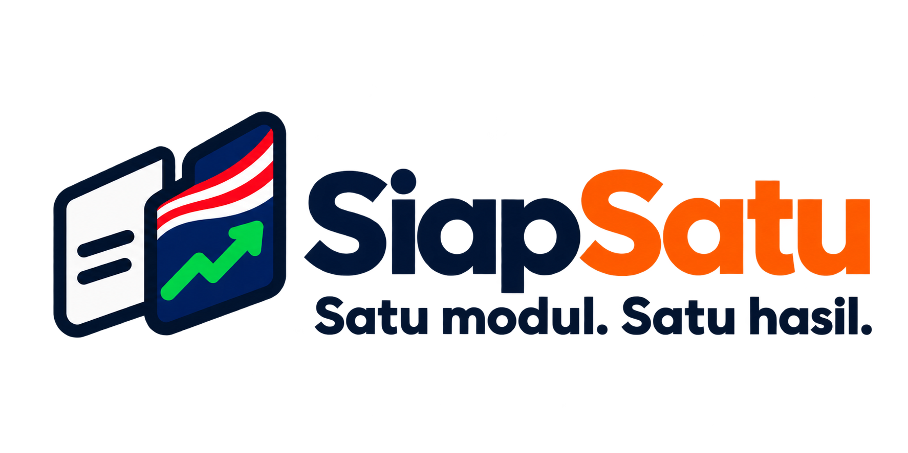
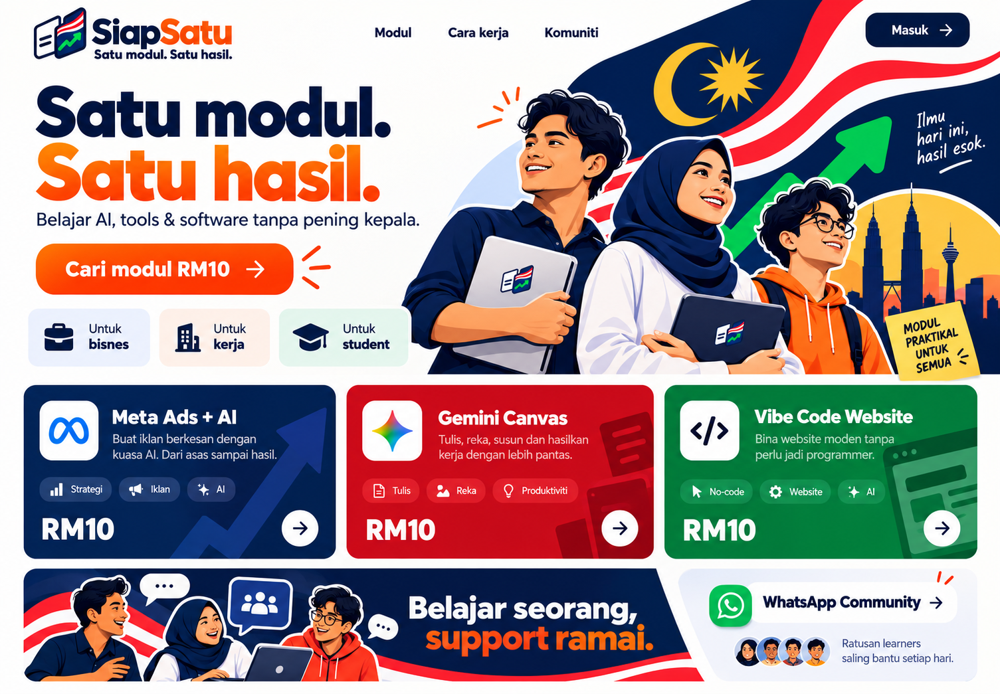

# SiapSatu

<div align="center">
  
  <p><strong>Platform Belajar Tools AI untuk Malaysia — Satu Modul. Satu Hasil.</strong></p>
  <p>Panduan praktikal dalam Bahasa Melayu untuk membina website, automasi kerja, prototaip app, AI agent dan content dengan kos RM10 per modul.</p>

  <p>
    <a href="https://siapsatu.syahmiaof.my"></a>
    <a href="https://nextjs.org"></a>
    <a href="https://www.typescriptlang.org"></a>
    <a href="https://playwright.dev"></a>
  </p>

  <br />
  
  <br />
</div>

---

## 💡 Mengenai SiapSatu

**SiapSatu** ialah platform pembelajaran mikro praktikal (micro-learning LMS) yang direka khas untuk rakyat Malaysia — merangkumi **pelajar, pemilik bisnes, dan staf pejabat**. 

Berbeza dengan kursus teori yang panjang dan mahal, SiapSatu berpegang kepada prinsip:
* **Satu modul, satu hasil praktikal yang boleh terus diuji**.
* **RM10 setiap modul mandiri** — tiada yuran tersembunyi atau langganan wajib.
* **Bahasa Melayu yang santai dan mudah difahami** — tak perlu jadi orang IT untuk mula bina sesuatu dengan AI.

---

## 🚀 5 Laluan Pembelajaran Utama

| Laluan | Janji Teknikal | Status Produk | Modul Berkaitan |
|:---|:---|:---|:---|
| **01 · Website live** | Brief → Bina → Deploy | Modul Aktif | [`vibe-code-website`](src/data/mockData.ts) |
| **02 · App & sistem tanpa coding** | Form → Data → Dashboard | Dalam Perancangan | [Koleksi Tools Produktiviti](/tools?category=productivity) |
| **03 · AI agent** | Arahan → Tools → Tindakan | Dalam Perancangan | [Koleksi Tools AI](/tools?category=ai) |
| **04 · Automasi kerja** | Trigger → Proses → Output | Modul Aktif | [`n8n-google-sheets`](src/data/mockData.ts) |
| **05 · Content AI** | Idea → Imej, Video & Lagu | Dalam Perancangan | [Koleksi Tools Reka Bentuk](/tools?category=design) |

> *Semua modul dalam perancangan dilabel secara jujur dan tidak mempunyai sebarang aliran pembelian palsu.*

---

## 🛠️ Tech Stack & Senibina

* **Core Framework:** [Next.js](https://nextjs.org/) 14.2 (App Router & Static Generation)
* **Frontend UI:** [React](https://react.dev/) 18 & [TypeScript](https://www.typescriptlang.org/) (Strict Mode)
* **Styling System:** CSS Modules dengan token warna & tipografi tersuai ([`src/styles/tokens.css`](src/styles/tokens.css))
* **Motion & Interactivity:** [GSAP](https://gsap.com/) 3 & ScrollTrigger (`@gsap/react`)
* **Ikon & Logo:** Vector SVG rasmi untuk 66+ tools AI & dev + [Lucide React](https://lucide.dev/) untuk UI glyphs
* **Ujian & Kualiti:** [Playwright](https://playwright.dev/) Test Suite (80 test kes merangkumi Desktop & Mobile viewports)
* **Automasi CI:** GitHub Actions ([`.github/workflows/ci.yml`](.github/workflows/ci.yml))

---

## 📁 Struktur Repositori

```text
academy-syahmi/
├── .github/
│   └── workflows/
│       └── ci.yml               # GitHub Actions CI (Typecheck, Lint & Build)
├── docs/
│   ├── specs/                   # Spesifikasi produk, strategi bisnes & reka bentuk
│   │   ├── PRODUCT.md           # Fakta produk rasmi & skop pelaksanaan
│   │   ├── DESIGN.md            # Sistem visual tokens & tipografi
│   │   ├── BUSINESS_STRATEGY.md # Model ekonomi RM10 & perancangan modul
│   │   ├── RESEARCH.md          # Penyelidikan pasaran Malaysia & audiens
│   │   ├── UI_PLAN.md           # Struktur antaramuka & aliran pengguna
│   │   └── BRAND_COPY.md        # Panduan copy & nada suara jenama
│   ├── prompts/                 # Arkib master agent prompts & QA briefing
│   ├── ASSET_SOURCES.md         # Sumber asal & lesen setiap logo/aset
│   └── VISUAL_QA.md             # Matriks semakan kualiti visual & bukti ujian
├── mockups/                     # Rujukan mockup asal yang telah diluluskan
├── public/
│   ├── assets/
│   │   ├── brand/               # Aset logo & simbol SiapSatu
│   │   ├── home/                # Slices WebP berkualiti tinggi untuk homepage
│   │   └── tools/               # 66+ logo rasmi tools AI & pembangun
│   └── og-image.png             # Kad preview OpenGraph & media sosial terkini
├── src/
│   ├── app/                     # Next.js App Router (15 route statik)
│   ├── components/              # Komponen modular (Home, Brand, Navigation, Tools, dll.)
│   ├── data/                    # Data mock katalog modul & katalog 66 tools
│   ├── lib/                     # Utiliti bantuan & integrasi GSAP
│   └── styles/                  # Token reka bentuk global & reset CSS
├── tests/                       # Playwright test specs (E2E, navigation, visual QA)
├── package.json                 # Konfigurasi dependensi & skrip npm
├── playwright.config.ts         # Konfigurasi peranti & viewport ujian
└── tsconfig.json                # Konfigurasi TypeScript strict
```

---

## 🗺️ Senarai Route Utama

| Route | Penerangan Halaman |
|:---|:---|
| `/` | Homepage utama berorientasikan image-first dengan 5 laluan visual |
| `/modules` | Katalog penuh modul dengan carian dan tapisan mengikut kategori |
| `/tools` | Direktori 66 tools AI, automasi, pembangunan perisian & MCP |
| `/tools/[slug]` | Halaman khas setiap tool (cth: n8n, Hermes Agent) |
| `/paths/ai-automation` | Laluan pembelajaran bertahap 4 langkah (AI Automation) |
| `/modules/[slug]` | Halaman butiran modul RM10 & pratonton checkout |
| `/learn/[slug]/[step]` | Pembaca modul langkah-demi-langkah dengan butang salin template |
| `/library` | Dashboard modul yang telah dipelajari oleh pengguna |
| `/progress` | Peta kemajuan kemahiran & pencapaian hasil |
| `/community` | Hub komuniti latihan, perkongsian hasil & saluran WhatsApp |
| `/login` | Antaramuka log masuk OTP yang ringkas dan bersih |

---

## 📚 Dokumentasi Projek

* 📋 [Spesifikasi Produk](docs/specs/PRODUCT.md) — Fakta, had dan skop perkhidmatan
* 🎨 [Panduan Sistem Reka Bentuk](docs/specs/DESIGN.md) — Palet warna, tipografi dan grid
* 💼 [Strategi Bisnes](docs/specs/BUSINESS_STRATEGY.md) — Model harga RM10 & pelan katalog
* 🔬 [Penyelidikan Pasaran](docs/specs/RESEARCH.md) — Bukti keperluan audiens Malaysia
* 🖼️ [Sumber Aset & Logo](docs/ASSET_SOURCES.md) — Rekod sumber sah untuk 66+ tools
* 🤖 [Arkib Master Prompts](docs/prompts/) — Dokumentasi arahan ejen AI

---

## 📄 Lesen & Hak Cipta

© 2026 **SiapSatu**. Hak cipta terpelihara.
Direka dan dibangunkan dengan penuh teliti untuk komuniti pembelajaran teknologi Malaysia.
